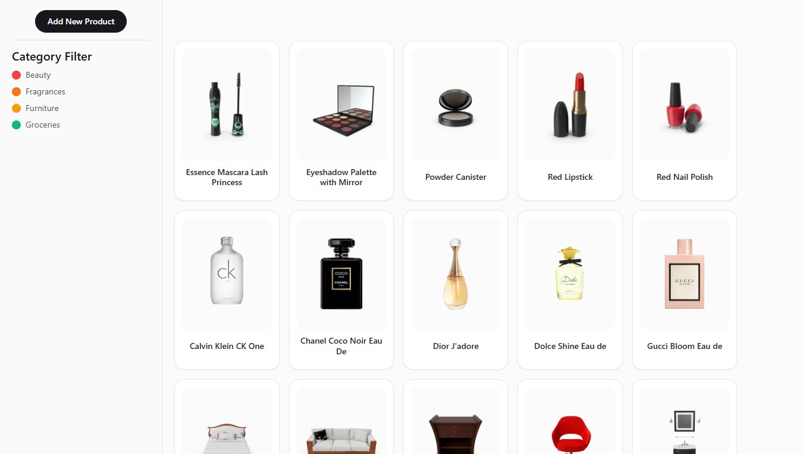
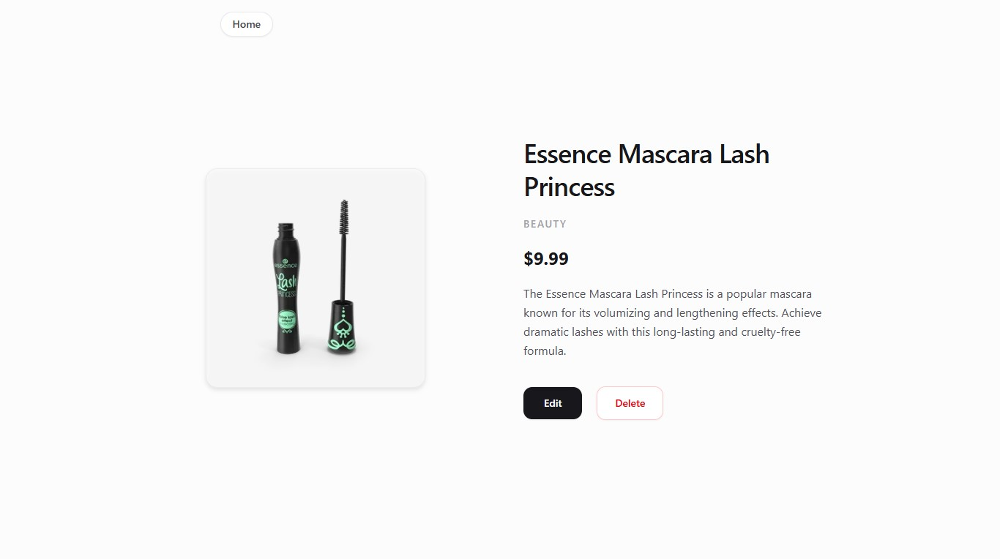
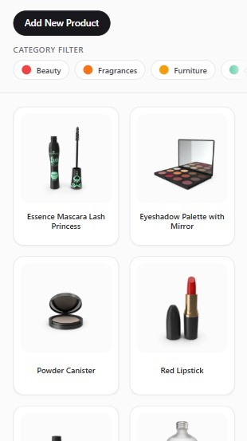

# React Product Store


A responsive product management app built with React, Tailwind CSS and the Context API. Browse products, filter by category, and add, edit or delete items. The layout adapts smoothly from 320px phones to large desktop screens.

**[Live Demo](https://react-product-store-three.vercel.app/)**

## Screenshots

### Desktop

| Home | Product Details |
|------|-----------------|
|  |  |

### Mobile

| Home | Form |
|------|---------|------|
|   |

## Features

- **Product catalog** with image, title and category, loaded from the DummyJSON API on the first visit
- **Category filtering** with a highlighted active category
- **Full CRUD**: add, edit and delete products, with Cancel buttons on both forms
- **Form validation** with clear, specific error messages and dollar-only price rules
- **Responsive design** from 320px to 1920px and above
- **LocalStorage persistence**, so changes survive a page refresh
- **Toast notifications** for success and error feedback
- **Clean UI** with a soft neutral palette, rounded cards, and hover and focus states

## Responsive Design

| Screen | Layout |
|--------|--------|
| Phones (below 768px) | Stacked layout, top bar, scrollable category chips, 2-column grid |
| Tablets (768px to 1023px) | 3-column grid |
| Laptops (1024px to 1279px) | 4-column grid with sidebar |
| Desktops (1280px and above) | Sidebar with 5-card product rows |

## Tech Stack

| Area | Tools |
|------|-------|
| Framework | React 19, Vite |
| Routing | React Router DOM (HashRouter) |
| Styling | Tailwind CSS v4 |
| State | Context API |
| Data | Axios, DummyJSON API, LocalStorage |
| Utilities | React Toastify, Nanoid |
| Deployment | Vercel |

## Getting Started

```bash
# 1. Clone the repository
git clone https://github.com/kenil948/react-product-store.git

# 2. Go to the project folder
cd react-product-store

# 3. Install dependencies
npm install

# 4. Start the development server
npm run dev
```

The app runs at `http://localhost:5173/`. To create a production build, run `npm run build`.

## Project Structure

```bash
react-product-store/
├── public/
├── src/
│   ├── assets/
│   │   └── screenshots/
│   ├── components/
│   │   ├── Create.jsx
│   │   ├── Details.jsx
│   │   ├── Edit.jsx
│   │   ├── Home.jsx
│   │   ├── Loader.jsx
│   │   └── Navbar.jsx
│   ├── utils/
│   │   ├── axios.jsx
│   │   └── Context.jsx
│   ├── App.jsx
│   ├── index.css
│   └── main.jsx
├── index.html
├── package.json
└── vite.config.js
```

## How It Works

- On the first visit, products are fetched from the [DummyJSON](https://dummyjson.com/) API and stored in Context and LocalStorage.
- After that, the app reads from LocalStorage, so your added, edited and deleted products persist in your browser.
- Data is stored per browser, so changes aren't shared between devices.
- To reset to the original products, clear the site's LocalStorage.

## Future Improvements

- Search bar for products
- Sorting by price
- Image upload instead of image links
- Backend and database for shared data

## What I Learned

- State management with the Context API
- CRUD operations and LocalStorage persistence
- Routing with React Router
- Responsive, mobile-first design with Tailwind CSS
- Form validation and user-friendly error messages
- Code cleanup and deployment with Vite and Vercel

## Author

**Kenil**: [GitHub](https://github.com/kenil948)
